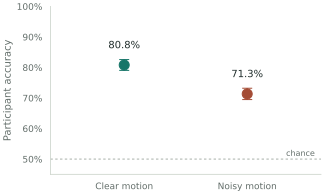

```{=html}
<div class="workshop-badge"><span class="badge-dot"></span> THE NEUROSCIENCE LAB WORKSHOP <span>·</span> NOVEMBER 2026</div>
<section class="hero" aria-label="Introduction">
<div><div class="eyebrow">FROM EXPLORATION TO REPRODUCTION</div>
<h1>Your next analysis.<br><em>Built to last.</em></h1>
<p class="intro">Keep the curiosity of a notebook. Add clear functions, explicit choices, and a workflow your lab can reproduce. Learn it all through one motion-perception experiment.</p>
<div class="hero-actions"><a class="button-primary" href="modules/01-foundations.html">Start the learning path <span data-icon="arrow"></span></a><a class="button-secondary" href="notebook-lab.html"><span data-icon="play"></span> Open Python lab</a></div>
<p class="small-note">You know basic Python. We'll take it from there.<br>No installation needed for the browser labs.</p></div>
<div class="research-card"><div class="card-top"><div><div class="window-dots" aria-hidden="true"><span></span><span></span><span></span></div><span>motion-perception / results</span></div><span class="status-pill"><span class="status-dot"></span> Reproduced</span></div>
<div class="figure"></div>
<div class="card-caption"><span>24 synthetic participants</span><span>One experiment. Three code stages.</span></div>
<div class="card-code"><span class="code-comment"># Same settings. Notebook or script.</span><br><span class="code-accent">from</span> experiment.config <span class="code-accent">import</span> load_config<br>config = load_config("config/analysis.toml")</div></div>
</section>
<div class="meta-strip"><span><b>6 modules</b>One connected learning path</span><span><b>2 live labs</b>Learn by changing real examples</span><span><b>90 minutes</b>A guided workshop for your lab</span><span><b>100% synthetic</b>Real habits, teaching data</span></div>
<div class="section-head"><h2>Less setup. More discovery.</h2><p>Jump in and make a change.</p></div>
<div class="quick-labs">
<a class="quick-lab" href="notebook-lab.html"><span class="lab-card-icon" data-icon="notebook"></span><div><span class="eyebrow">LIVE PYTHON · 4 MISSIONS</span><h3 class="no-anchor">The notebook lab</h3><p>Catch hidden state. Extract a module. Reproduce the figure.</p></div><span data-icon="arrow"></span></a>
<a class="quick-lab" href="git-playground.html"><span class="lab-card-icon" data-icon="git"></span><div><span class="eyebrow">GIT SIMULATION · 5 MISSIONS</span><h3 class="no-anchor">The Git practice room</h3><p>Stage a decision. Resolve a conflict. Share and review it.</p></div><span data-icon="arrow"></span></a>
</div>
<div class="section-head"><h2>One project. A better workflow.</h2><p>Follow the analysis as it evolves.</p></div>
<div class="journey" aria-label="Learning progression">
<div class="journey-step"><span>01</span><strong>Explore</strong><small>Ask a question in a notebook</small></div>
<div class="journey-step"><span>02</span><strong>Extract</strong><small>Give repeated logic a function</small></div>
<div class="journey-step"><span>03</span><strong>Organize</strong><small>Share code and configuration</small></div>
<div class="journey-step"><span>04</span><strong>Review</strong><small>Make every change explainable</small></div>
<div class="journey-step"><span>05</span><strong>Reproduce</strong><small>Let a labmate run it again</small></div>
</div>
```

## Built around the work you already do

You already write Python and pandas analyses. Here, you'll improve their names, responsibilities, configuration, and reproducibility. Git starts from first principles. We follow a fully synthetic visual motion discrimination experiment: load trials, apply an explicit exclusion rule, compare conditions, and generate a scientific figure.

The core lessons take about three hours. The [90-minute workshop](workshop.qmd) selects the essentials; the live labs and [personal handoff plan](practice.qmd) let you practice further.

```{=html}
<div class="section-head"><h2>The learning path</h2><p>Go in order, or return to what you need.</p></div>
<div class="module-list">
<a class="module-card" href="modules/01-foundations.html"><span class="module-number">01</span><div><h3 class="no-anchor">Clean code & meaningful names ↗</h3><p>Review an analysis for intent, units, table state, function contracts, and hidden scientific assumptions.</p><small>20 MIN · REVIEW FOR MEANING</small></div></a>
<a class="module-card" href="modules/02-notebooks.html"><span class="module-number">02</span><div><h3 class="no-anchor">The notebook as an interface ↗</h3><p>Separate exploration from shared logic. Make run settings, intermediate data, and outputs inspectable.</p><small>20 MIN · KEEP THE EXPLORATION</small></div></a>
<a class="module-card" href="modules/03-refactoring.html"><span class="module-number">03</span><div><h3 class="no-anchor">From cells to functions ↗</h3><p>Compare real code at three stages. Extract repeated logic without changing the scientific result.</p><small>35 MIN · THE CORE TRANSFORMATION</small></div></a>
<a class="module-card" href="modules/04-projects.html"><span class="module-number">04</span><div><h3 class="no-anchor">Projects & shared configuration ↗</h3><p>Load validated TOML settings, run baseline and sensitivity analyses, and record what produced each result.</p><small>35 MIN · A HOME FOR YOUR CODE</small></div></a>
<a class="module-card" href="modules/05-git.html"><span class="module-number">05</span><div><h3 class="no-anchor">Git, one change at a time ↗</h3><p>Separate a refactor from a policy change. Take a new analysis config through a branch and pull request.</p><small>45 MIN · LEARN BY DOING</small></div></a>
<a class="module-card" href="modules/06-reproducibility.html"><span class="module-number">06</span><div><h3 class="no-anchor">Reproduce it together ↗</h3><p>Hand over code, settings, data provenance, and run records so another researcher can audit the result.</p><small>25 MIN · CLOSE THE LOOP</small></div></a>
</div>
<div class="feature-ribbon"><p><strong>Take the workflow back to your lab.</strong>Three working notebooks, a tested Python package, and synthetic data. Yours to explore and adapt.</p><a class="button-primary" href="downloads/motion-perception.zip" download><span data-icon="download"></span> Get the materials</a></div>
<p class="small-note"><a href="setup.html">Local setup instructions</a> · <a href="workshop.html">90-minute workshop run sheet</a> · <a href="practice.html">Make a handoff plan</a></p>
```
